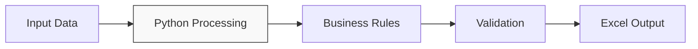
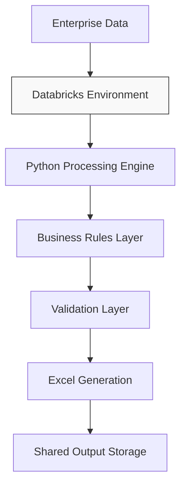
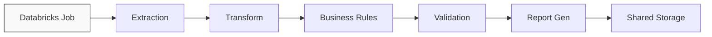

# Enterprise Data Automation & Databricks Migration
From a locally executed Python workflow to a centralized, automated data-processing architecture in Databricks.

## Overview
This repository documents the engineering evolution of a recurring business data process, migrating it from local Python execution into a centralized Databricks workflow. 

The original pipeline processed multiple data sources, applied deterministic business rules, validated records, enriched datasets, and generated a standardized Excel deliverable. The updated architecture focuses on centralized execution, repeatability, automated validation, and operational continuity.

## Tech Stack
* **Language & Core Libraries:** Python, Pandas, openpyxl
* **Platform & Infrastructure:** Databricks
* **Automation Target:** Excel Automation
* **Version Control:** Git / GitHub

## The Challenge
The legacy workflow required multiple manual or fragmented processing steps before delivering a business-ready dataset:
* Data extraction and cleansing
* Data transformation and enrichment
* Business-rule evaluation and record validation
* Priority classification and Excel report generation

Executing this process locally introduced a significant operational bottleneck: pipeline execution depended entirely on a specific workstation and a local Python environment. The objective of this migration was to eliminate these hardware dependencies and redesign the pipeline for a centralized, reproducible, and cloud-managed environment.

---

## Architecture Evolution

### Phase 1 — Local Python Automation
The initial implementation consolidated the manual business process into a unified Python script, moving away from manual spreadsheet transformations to a deterministic code-based execution.



### Phase 2 — Business Rules and Data Validation
To ensure long-term maintainability, the codebase was refactored to decouple data transformations, business logic evaluation, validation constraints, and exception detection. This modular structure simplified testing and isolating data anomalies.

### Phase 3 — Automated Excel Generation
The final step of the local phase utilized `openpyxl` to automate formatting, structuring, and generating the final Excel deliverable. This removed human intervention from the reporting phase and guaranteed structural consistency across deliveries.

### Phase 4 — Databricks Migration
The architecture was re-engineered to run natively within Databricks. This shift eliminated dependencies on local Python runtimes and manual data preparation, centralizing all execution stages inside a managed data environment.



### Phase 5 — Job-Based Automation
The final state transitions the pipeline into an automated Databricks Job workflow, maximizing repeatability and reducing manual execution triggers to a minimum.



---

## Project Structure

```bash
enterprise-data-automation/
│
├── data/
│   ├── raw/
│   └── reference/
│
├── src/
│   ├── extract.py
│   ├── transform.py
│   ├── business_rules.py
│   ├── validation.py
│   └── excel_generator.py
│
├── notebooks/
│   └── databricks_pipeline_demo.py
│
├── tests/
│   └── test_business_rules.py
│
├── output/
│
└── docs/
    └── architecture/
```

---

## Engineering Principles

* **Modular Processing:** Extraction, transformation, business rules, validation, and output generation are isolated into distinct software components.
* **Deterministic Logic:** Business decisions that follow explicit criteria are coded as strict Python rules, avoiding opaque or hardcoded decision layers.
* **Validation Before Output:** Data records are evaluated against quality thresholds before the final report is generated, isolating exceptions prior to downstream consumption.
* **Idempotency and Reproducibility:** Given the same input data and configuration parameters, the pipeline guarantees identical output runs.
* **Operational Continuity:** Infrastructure choices prioritize reducing dependency on single developer workstations or fragmented local environments.

---

## Portfolio Version Disclaimer
This repository serves as a portfolio-oriented recreation of an enterprise automation architecture. All datasets included are synthetic and designed exclusively for demonstration purposes.

This codebase **does not** contain:
* Production customer data or proprietary enterprise datasets
* Internal table names, schemas, or network URLs
* Authentication credentials, tokens, or production secrets
* Proprietary production source code

The public implementation showcases engineering concepts, architectural design, and modern development frameworks without exposing confidential corporate assets.

## Core Core competencies Demonstrated
* End-to-end Python automation and modular software design
* Enterprise data transformation pipelines and validation frameworks
* Databricks workflow migration and job-based cloud scheduling
* Operational continuity strategy and legacy system modernization
