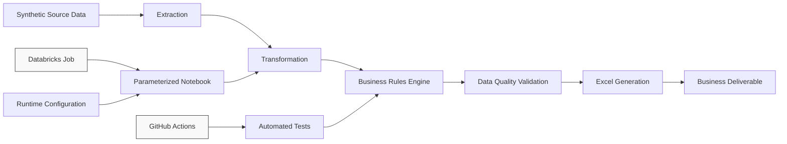
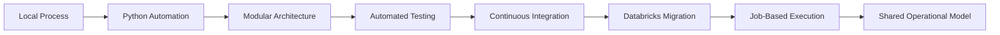
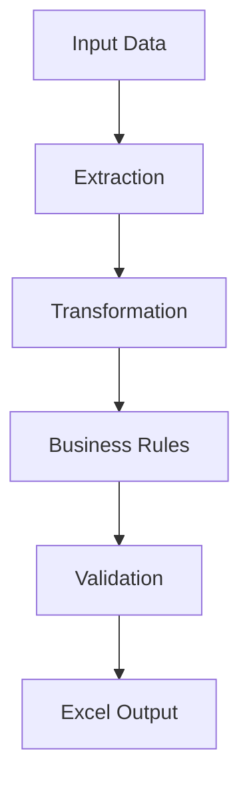
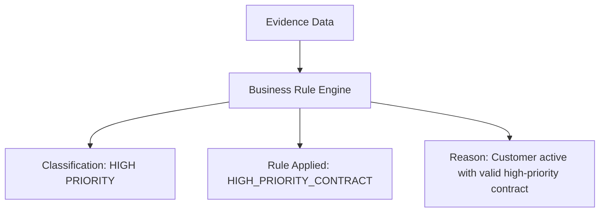
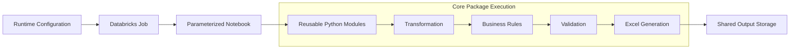
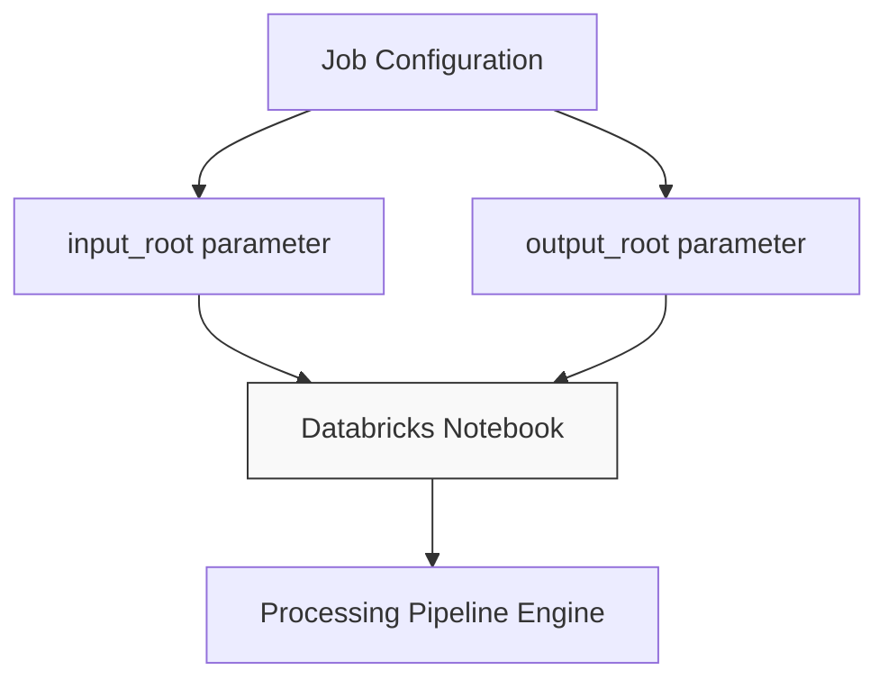
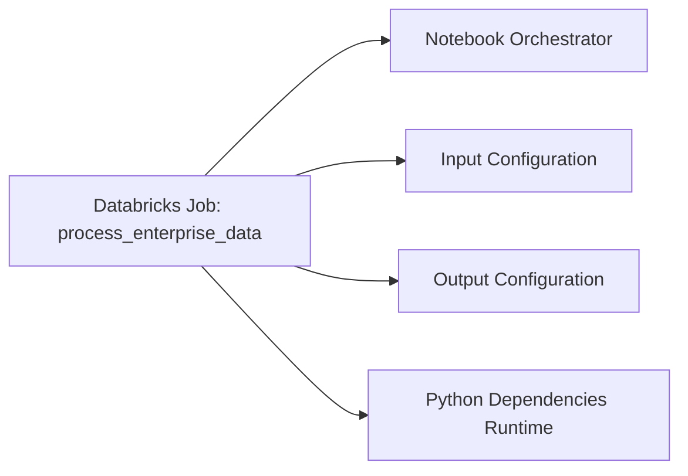

# Enterprise Data Automation & Databricks Migration
A portfolio case study demonstrating the evolution of a locally executed Python workflow into a modular, tested, and Databricks-oriented automation architecture.

## Overview
This project demonstrates how a recurring business data workflow can evolve from a fragmented local setup into a structured automation solution. The architecture centers on modular processing, data validation, deterministic rules, and cloud infrastructure integration using synthetic data to showcase enterprise production patterns safely.

## Technology Stack
* **Core Runtime & Libraries:** Python, Pandas, openpyxl, pytest
* **Orchestration & CI/CD:** Databricks Jobs, GitHub Actions
* **Deliverable Target:** Excel Automation

---

## The Business Challenge
Operational workflows often originate as manual processes dependent on standalone spreadsheets and local execution. Scaling these processes introduces distinct engineering bottlenecks:
* Repetitive manual data preparation and user-specific path dependencies.
* Business rules implemented inconsistently across isolated scripts.
* Lack of robust validation layers prior to downstream delivery.
* High dependence on local workstations, limiting operational continuity and testing depth.

The objective of this architecture is to decouple the processing components entirely:
```text
Data ➔ Business Logic ➔ Validation ➔ Execution ➔ Configuration ➔ Output
```
Decoupling these layers ensures that each component can evolve, test, and scale independently.

---

## Solution Architecture
The resulting framework isolates the pipeline responsibilities into dedicated operational layers.


*For comprehensive architectural specifications, please refer to the [System Architecture](docs/architecture/) documentation.*

---

## Architecture Evolution



### Phase 1: Local Python Automation
The initial iteration unified the fragmented workflows into a single entry-point execution script.


The local pipeline is orchestrated via `python main.py`. This script contains no hardcoded business rules; its sole structural responsibility is component orchestration.

### Phase 2: Modular Architecture
To prevent tight coupling, code responsibilities were extracted out of the main script and isolated into explicit packages within the `src/` directory:

* **`extract.py`**: Handles source data ingestion and enforces strict schema validation.
* **`transform.py`**: Standardizes data formats, handles date conversions, and consolidates disparate datasets.
* **`business_rules.py`**: Manages business classification rules, handles precedence routing, and logs decision reasons.
* **`validation.py`**: Evaluates record-level data quality thresholds, splitting results into warnings and critical errors.
* **`excel_generator.py`**: Compiles processing summaries, builds dynamic views, and applies strict workbook styling.

---

## Core Framework Implementations

### Explainable Business Rules
Deterministic decisions remain transparent and fully auditable. The core Rules Engine processes the available data evidence and appends contextual metadata directly to each record:


This architecture preserves clear lineage and full audit traceability from the raw input fields to the final reporting layers.

#### Business Classifications Matrix

| Classification | Purpose |
| :--- | :--- |
| `STANDARD` | Valid standard business processing scenario. |
| `HIGH PRIORITY` | Valid business condition requiring prioritized downstream handling. |
| `REVIEW` | Data structure is correct, but specific indicators require operational audit. |
| `EXCEPTION` | Processing stopped due to an explicit business logic or configuration anomaly. |

### Decoupled Data Quality Validation
Data validation errors and business priority classifications are managed independently. This approach permits complex scenarios where a record is structurally sound but flags a business-level anomaly (e.g., `classification = REVIEW` alongside `validation_status = PASSED`).

#### Data Quality Status Flags
* **`PASSED`**: Record meets all technical structural and relation thresholds.
* **`WARNING`**: Non-critical issue detected; processing completes but logs the anomaly.
* **`FAILED`**: Critical schema or data error; record is isolated from normal downstream flows.

---

### Automated Excel Deliverable
The `excel_generator` module automatically compiles the verified processing sets into an enterprise-ready `enterprise_automation_report.xlsx` file using four production-ready layouts:

1. **`SUMMARY`**: Provides executive processing KPIs, highlighting record volume totals, classification distributions, and validation metrics.
2. **`MASTER`**: Contains the full record lifecycle including raw data columns, rules applied, explainability logs, and quality status flags.
3. **`PRIORITIES`**: A filtered operational view isolating high-priority records and exceptions requiring rapid attention.
4. **`REVIEW`**: Aggregates records that completed technical validation but failed specific business rules, isolating them for analysts.

*All views automatically receive human-friendly structural enhancements, including frozen headers, data filtering, and adjusted column dimensions.*

---

## Testing & Quality Assurance

### Unit & End-to-End Testing
The testing suite utilizes `pytest` to validate deterministic rule evaluation under clear edge-case boundaries (such as invalid date bounds, expired agreements, missing parameters, and customer status changes).

* **Fixed Evaluation Timestamps:** Tests evaluate date logic against an unshifting, static runtime parameter rather than using live environment dates. This removes non-deterministic testing behavior.
* **E2E Integration Verification:** The continuous integration pipeline programmatically runs the complete pipeline end-to-end, writing an output workbook and reloading it via code to assert structural stability and tab configurations.

### Continuous Integration (CI)
A rigorous GitHub Actions workflow acts as a quality gate for every codebase change:


---
### Phase 3: Databricks Migration
The final evolutionary step isolates the execution environment entirely from the core processing modules. Databricks handles compute infrastructure, cluster management, and job orchestration, executing the portable Python packages without changes to business rules. 

The fundamental architectural decision during this migration is that **Databricks does not introduce a second implementation of the business rules**. The same processing concepts remain entirely reusable while the underlying compute and execution models change. Databricks-specific orchestration is isolated completely within the execution environment layer.



#### Parameterized Execution
The Databricks notebook decouples infrastructure from application logic by receiving environment-specific storage configurations through runtime parameters, eliminating hardcoded user paths.


*This mechanism enforces a strict architectural boundary between Code, Configuration, Data, Execution, and Output.*


#### Job-Based Architecture
The repository includes a production-ready job configuration blueprint (`job_config.json`) demonstrating how execution orchestration is maintained independently from processing assets.


*For supplementary infrastructure details, review the [Databricks Job Architecture](docs/databricks-job-architecture.md) documentation.*

#### Operational Continuity Strategy
The ultimate architectural goal of this project is to scale past workstation-dependent constraints toward a highly available, shared governance model:

```text
Developer Workstation ➔ Local Python Runtime ➔ Local Output
                          ↓
Centralized Config ➔ Managed Cloud Execution ➔ Reusable Core Engine ➔ Shared Output Storage
```
*Note: Production-level deployment concerns such as identity access management (IAM), data persistence tiers, network security, and enterprise logging pipelines remain the sole operational responsibility of the consuming organization.*

---

## Repository Structure

```bash
enterprise-data-automation/
│
├── main.py                           # Local execution entry point
├── README.md                         # Main repository documentation
├── requirements.txt                  # Application dependencies
├── .gitignore                        # Git exclusion configuration
│
├── data/                             # Synthetic data layer
│   ├── raw/                          # Ingestion source files (customers, contracts)
│   └── reference/                    # Rule definitions (priority_rules)
│
├── src/                              # Core processing engine
│   ├── __init__.py
│   ├── extract.py                    # Ingestion & structural validation
│   ├── transform.py                  # Normalization & consolidation
│   ├── business_rules.py             # Evaluation & classification
│   ├── validation.py                 # Technical quality verification
│   └── excel_generator.py            # Report generation & styling
│
├── tests/                            # Automated testing suites
│   ├── test_business_rules.py        # Business logic unit tests
│   └── test_pipeline.py              # End-to-end integration validation
│
├── notebooks/
│   └── databricks_pipeline_demo.py   # Databricks execution notebook
│
├── databricks/
│   ├── job_config.json               # Infrastructure job blueprint
│   └── README.md                     # Deployment instructions
│
├── docs/                             # Extended technical documentation
│   ├── databricks-job-architecture.md
│   └── architecture/
│       └── system-architecture.md    # Detailed architecture deep dive
│
├── output/                           # Local execution target directory
│
└── .github/
    `-- workflows/
        `-- tests.yml                 # Continuous Integration workflow
```

---

## Running the Portable Python Pipeline

### 1. Clone the repository
```bash
git clone <repository-url>
cd enterprise-data-automation
```

### 2. Configure the Python Environment
```bash
python -m venv .venv
source .venv/bin/activate  # On Windows use: .venv\Scripts\activate
```

### 3. Install Application Dependencies
```bash
python -m pip install -r requirements.txt
```

### 4. Run Automated Testing Suite
```bash
python -m pytest tests -v
```

### 5. Execute Pipeline locally
```bash
python main.py
```
*Upon successful local execution, the final output workbook will be generated at: `output/enterprise_automation_report.xlsx`*

---

## Key Engineering Decisions

1. **Separation of Logic from Orchestration:** Both `main.py` and the Databricks notebook coordinate sequence execution but delegate all business rule evaluations to the portable core package.
2. **Immutability of Deterministic Rules:** Compliance and business processing logic remain explicitly implemented as testable Python modules rather than embedded in fragile platform assets or database views.
3. **Auditability of Outcomes:** Every data state change captures both the technical rule triggered and a human-readable reason string.
4. **Data Quality Isolation:** Business exception routing (e.g., `REVIEW`) is decoupled from technical validation failures to prevent processing blocks on structurally clean data.
5. **Relationship Enforcement:** Joins include strict cardinal validation during transformations to identify and prevent silent record multiplication or data loss.
6. **Preservation of Missing Keys:** Left joins are carefully utilized to ensure that customers without active config definitions are captured as structured business anomalies instead of disappearing from reporting layers.

---

## Core Competencies Demonstrated

### Automation Engineering
* End-to-end processing automation and workflow orchestration.
* System translation of human business rules into predictable codebase logic.
* Automated enterprise workbook generation with precise visual styling.
* Robust boundary and exception routing strategies.

### Python & Data Engineering
* Modular enterprise application architectures.
* Complex Pandas transformations, dataset consolidation, and normalization.
* Structural data validation, runtime contract checking, and reference data enrichment.

### Software Quality & CI/CD
* Deterministic unit testing using fixed evaluation timestamps.
* Programmatic workbook structure and tab integration checks (E2E).
* Automated code quality gates managed via Continuous Integration (CI).

### Databricks Architecture
* Parameterized notebook designs ensuring environment independence.
* Reusable logic portability without vendor or cluster engine lock-in.
* Job-oriented cloud workflow orchestration and structural metadata outputs.

---

## Engineering Philosophy
Automation systems must do more than replace manual interface interactions. A resilient enterprise pipeline must answer six fundamental audit questions programmatically:

```mermaid
graph TD
    A[What data was received?] ➔ B[What transformations occurred?]
    B ➔ C[What exact rule was applied?]
    C ➔ D[Why was that decision made?]
    D ➔ E[Was the underlying data technically valid?]
    E ➔ F[What should downstream systems consume?]
```

This repository fulfills that philosophy by building transparent processing steps, complete traceability metrics, independent data quality blocks, and a total decoupling of business rules from execution environments.

---

## Portfolio & Data Privacy Disclaimer
This repository serves as an independent portfolio demonstration of modern engineering frameworks. All data sets utilized throughout the pipeline are completely synthetic and generated programmatically for demonstration purposes.

This repository **does not** contain proprietary corporate source code, real-world customer indicators, production data schemas, corporate workspace URLs, access credentials, tokens, or infrastructure secrets.

---

## Author
**Christian Jimenez**  
*Automation & AI/Agent Development Portfolio*

Focused on building practical automation systems that seamlessly connect business operations, deterministic decision logic, data engineering, and intelligent workflow designs.
