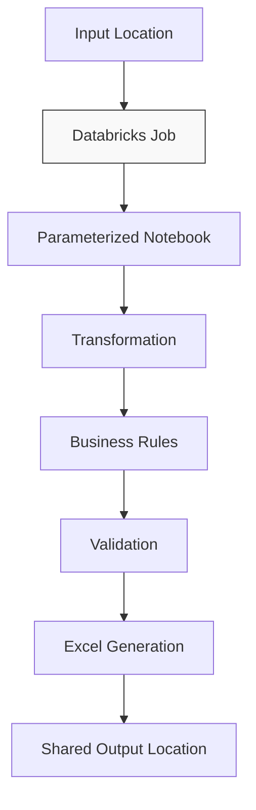
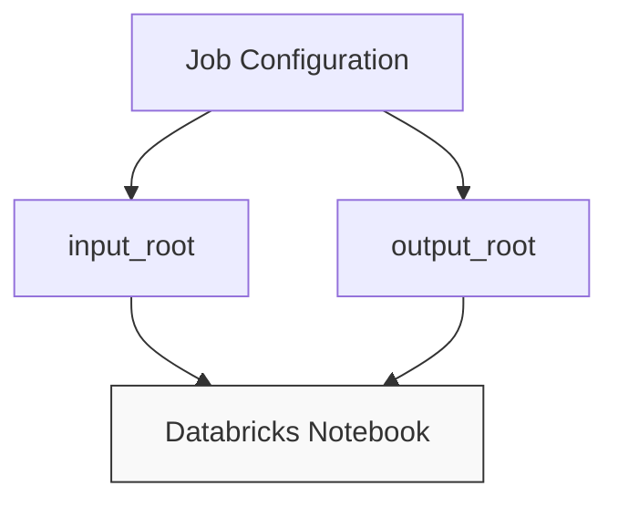
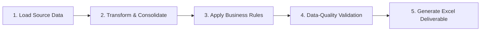
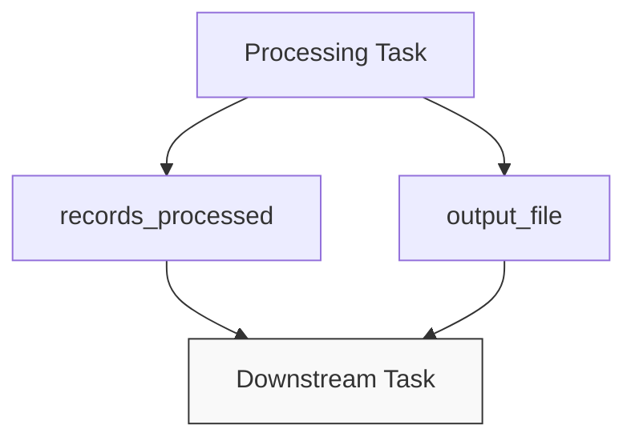
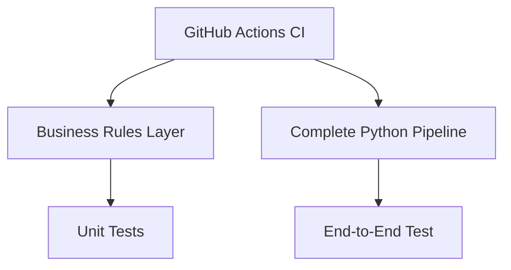

## Phase 2 — Databricks Execution

The Databricks-oriented implementation introduces a centralized execution layer. The core business modules remain entirely reusable, positioning Databricks as the orchestration and runtime platform rather than redefining the core business logic.



### Notebook Parameters
The demonstration notebook decouples input/output locations from the processing code by accepting two runtime parameters:

* **`input_root`**: The root directory containing the source datasets. The pipeline expects the following structure:
  ```bash
  input_root/
  ├── raw/
  │   ├── customers.csv
  │   └── contracts.csv
  └── reference/
      └── priority_rules.csv
  ```
* **`output_root`**: The destination directory for the business deliverable. The pipeline generates a single file named `enterprise_automation_report.xlsx` inside this configured location.


*Separating paths from logic ensures that the processing code remains immutable when infrastructure or data storage locations change.*

---

### Processing Task Execution
The core pipeline orchestrates the following sequential stages:



To maintain architectural portability and prevent platform lock-in, the underlying business logic remains in reusable Python modules rather than embedded inside notebook cells:
```bash
src/
├── transform.py
├── business_rules.py
├── validation.py
└── excel_generator.py
```

---

### Job Outputs & Downstream Extension Points
The orchestration notebook exposes key execution metrics as task outputs:
* `records_processed`
* `output_file`

These values act as metadata that can be passed dynamically to subsequent tasks in a larger workflow chain.


*Potential downstream tasks include output verification, automated publishing, or alerting systems. These components serve as architectural extension points and are omitted from this repository.*

---

### Error Handling & Categorization Strategy
The framework implements a **fail-fast** approach for environment, configuration, and structural structural anomalies (e.g., missing parameters, schema mismatches, or invalid dataset relationships).

In contrast, record-level anomalies do not terminate pipeline execution. Instead, data records are classified dynamically across two dimensions:

**Business Priority Classification:**
* `STANDARD`
* `HIGH PRIORITY`
* `REVIEW`
* `EXCEPTION`

**Data-Quality Evaluation:**
* `PASSED`
* `WARNING`
* `FAILED`

*This separation ensures the system can clearly distinguish between severe infrastructure infrastructure failures, data quality anomalies, and valid business exceptions.*

---

### Operational Continuity & Design Decoupling
A primary objective of this architecture is shifting from individual workstation reliance to shared operational ownership. This is achieved by explicitly decoupling five core layers:

```text
Code ➔ Configuration ➔ Data ➔ Execution ➔ Output
```

*Note: A production-ready deployment requires enterprise-level access controls, identity management (IAM), secure storage persistence, comprehensive logging/monitoring, and an SLA support model tailored to the organization's infrastructure.*

---

### Testing Strategy
The portable Python core is isolated and tested independently from the Databricks cluster environment using continuous integration.


*Keeping the business logic strictly decoupled allows for comprehensive unit testing without the overhead of initializing a Databricks runtime for every test run.*

---

### Portfolio Scope Disclaimer
This repository focuses strictly on architectural patterns and engineering principles using synthetic data. 

**This implementation explicitly excludes:**
* Production source code, customer records, or proprietary corporate data.
* Internal database table names, schemas, or enterprise workspace URLs.
* Authentication credentials, access tokens, or cloud job identifiers.
* Internal infrastructure configurations or deployment scripts.
