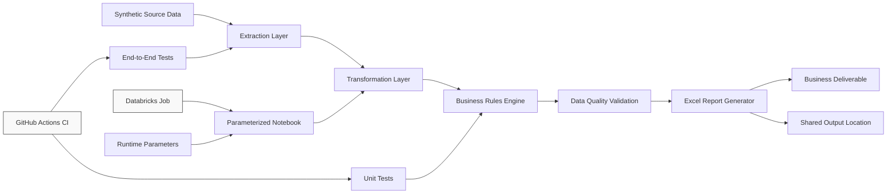
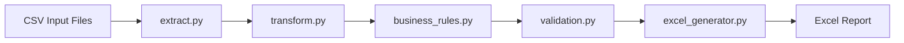
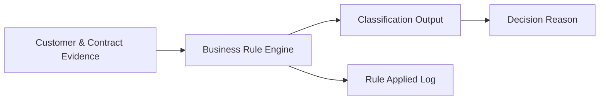
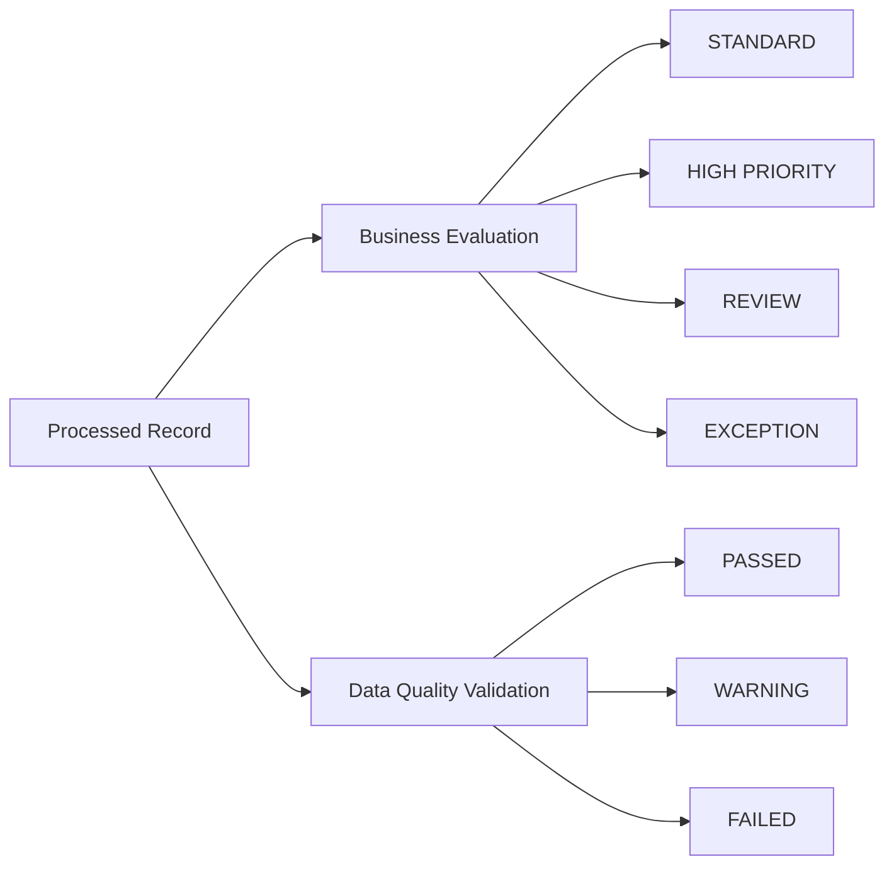
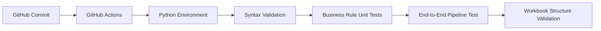
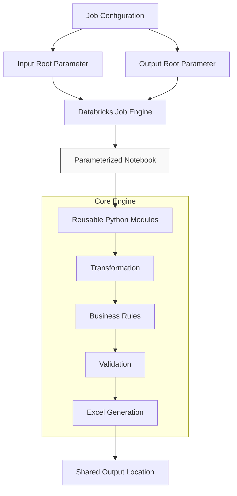
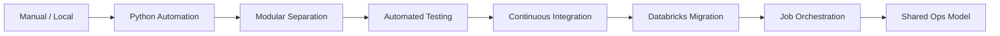

# System Architecture — Enterprise Data Automation & Databricks Migration
This document outlines the engineering evolution of a legacy, locally executed Python automation workflow into a modular, cloud-native, and rigorously tested architecture inside Databricks.

## Global Architecture Overview
The complete automation pipeline decouples core business logic from infrastructure orchestrators, ensuring that the same processing engine functions identically under local execution or managed cloud jobs.

---

## Component Breakdowns

### 1. Local Python Run Architecture
The baseline implementation executes the entire end-to-end pipeline through a standalone Python entry point. Code responsibilities are strictly separated between isolated modules rather than combined into a monolithic script.

### 2. Business Decision Framework
Business logic is deterministic, traceable, and explainable. Instead of opaque decision layers, each processed record explicitly captures its execution context for downstream compliance and clear lineage.

*Every record preserves its source evidence, final classification, specific rule applied, and a human-readable explanation to provide full traceability between raw data and final deliverables.*

### 3. Decoupled Data Quality Framework
Data quality and business priority evaluation are treated as entirely separate architectural concepts. This prevents technical pipeline bottlenecks when data satisfies structural criteria but requires manual business intervention.

*Under this design, an anomaly can flag a record for business review while the underlying dataset remains technically valid and structurally sound.*

### 4. Continuous Integration & Testing Framework
The pipeline includes continuous, automated validation of individual business rules as well as full-path testing via GitHub Actions.

*The end-to-end suite validates the full processing lifecycle, ensuring that data transformations, schema definitions, and generated Excel file architectures match specific criteria before deployment.*

### 5. Databricks Orchestration Architecture
The cloud-managed execution layer isolates runtime configuration parameters from core business engine code. The underlying execution platform scales independently without requiring a rewrite of the core processing logic.

---

## Architectural Evolution Path
The journey of this system represents the primary engineering narrative of the repository: transitioning a workstation-dependent runtime environment toward a centralized, testable, and robust enterprise design.

---

## Core Engineering Principles

* **Separation of Concerns:** Each component maintains a single, clearly isolated software responsibility.
* **Deterministic Logic:** Regulatory and business compliance rules are written as explicit, auditable code paths rather than black-box models.
* **Auditability & Explainability:** Business outcomes permanently log the underlying logic triggers alongside the final classification.
* **Testability:** Core business components remain decoupled from specific runtimes, allowing testing without cloud execution overhead.
* **Environment Independence:** System logic remains entirely decoupled from input, output, and infrastructure-specific definitions.
* **Operational Continuity:** Eliminates workstation dependency by completely separating code artifacts, environments, and data states.
